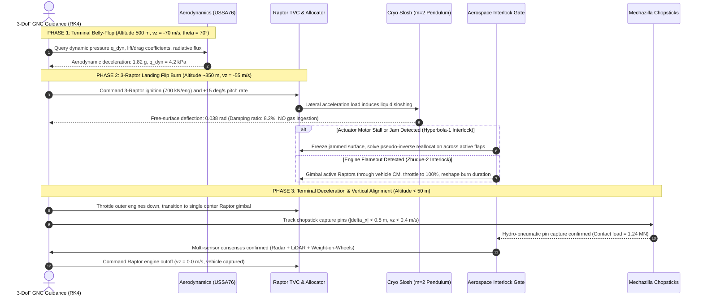

# Open-Starship

<p align="center">
  <a href="https://isihussain.github.io/open-starship/">
    
  </a>
</p>

<p align="center">
  <a href="https://github.com/isihussain/open-starship/actions/workflows/ci.yml"></a>
  <a href="https://isihussain.github.io/open-starship/"></a>
  <a href="https://github.com/isihussain/open-starship"></a>
  <a href="https://www.python.org"></a>
  <a href="https://github.com/isihussain/oxide-compiler"></a>
  <a href="LICENSE"></a>
</p>

<p align="center">
  <b><a href="#system-overview">System Overview</a></b> •
  <b><a href="#interactive-3d-webgl-mission-control">3D Visualizer</a></b> •
  <b><a href="#architecture--telemetry-flow">Architecture</a></b> •
  <b><a href="#sub-second-landing-flip--catch-sequence">Flip Sequence</a></b> •
  <b><a href="#aerospace-launch--flight-safety-interlocks">Safety Interlocks</a></b> •
  <b><a href="#geostationary--satellite-fleet-operations-türksat-azercosmos--hotbird">Satellite Fleet Operations</a></b> •
  <b><a href="#quickstart">Quickstart</a></b>
</p>

---

## System Overview

**Open-Starship** is an open-source engineering suite modeling physical dynamics, guidance algorithms, and operational safety interlocks across heavy-lift reusable launch vehicles, orbital propellant depots, and geostationary satellite platforms.

```
       500 m altitude ──►  70° Belly-Flop Descent (Terminal velocity: ~70 m/s)
                               │
       350 m altitude ──►  3-Raptor Ignition (700 kN/eng, +15° TVC pitch rate)
                               │
       150 m altitude ──►  Slosh Pendulum Damping (Ring baffles, ζ = 0.082)
                               │
        35 m altitude ──►  Chopstick Tower Lock (|Δx| < 0.5 m, vz < 0.4 m/s)
                               │
         0 m altitude ──►  Weight-on-Wheels Consensus Gate -> Engines Cutoff
```

The codebase contains four computational packages, a browser-based 3D mission control application, and an 8-phase pipeline orchestrator:

1. [**`starship-flip-gnc`**](file:///Users/johndoe/.gemini/antigravity/scratch/open-starship/starship-flip-gnc): 3-DoF trajectory optimizer, quaternion 3D attitude kinematics, thrust-vector control (TVC), Mechazilla chopstick tower capture solver, and aerospace flight safety interlocks.
2. [**`starship-cryo-slosh`**](file:///Users/johndoe/.gemini/antigravity/scratch/open-starship/starship-cryo-slosh): Reduced-order mechanical pendulum simulator for cryogenic propellant sloshing, ullage gas ingestion warnings, annular ring baffle damping, and in-space tanker-to-depot mass transfers.
3. [**`starship-tps-vision`**](file:///Users/johndoe/.gemini/antigravity/scratch/open-starship/starship-tps-vision): Aerothermal load risk mapping fused with multi-spectral tile imagery to identify, classify, and prioritize damaged hexagonal Thermal Protection System (TPS) heat-shield tiles.
4. [**`starship-geo-sat`**](file:///Users/johndoe/.gemini/antigravity/scratch/open-starship/starship-geo-sat): Geostationary and Earth observation satellite operations, electric orbit raising (EOR), zero-magnetic-field reaction wheel desaturation, adjacent satellite interference across 0.9° orbital proximity (Azerspace-1 & Azerspace-2), hypervelocity micro-debris collision diagnostics (AzerSky), and multi-spacecraft co-location via $e/i$ vector separation with Eurostar Neo migration (Hotbird 1 to 13G), derived from the Türksat, Azercosmos, and Eutelsat Hotbird programs.
5. [**`visualizer/`**](file:///Users/johndoe/.gemini/antigravity/scratch/open-starship/visualizer): Standalone 3D WebGL mission control simulator running directly in modern web browsers with zero installation.

---

## Interactive 3D WebGL Mission Control

Open the interactive cockpit in any modern web browser without dependencies, build steps, or servers:

<p align="center">
  <a href="https://isihussain.github.io/open-starship/">
    
  </a>
</p>

<p align="center">
  👉 <b><a href="https://isihussain.github.io/open-starship/">Launch Live Mission Control Simulation (GitHub Pages)</a></b>
</p>

The visualizer connects directly to generated flight telemetry or runs standalone real-time simulations across five dedicated subsystems:

| Tab | Subsystem Display | Physical & Visual Modeling |
| :--- | :--- | :--- |
| **🚀 Flight & GNC** | 3D Trajectory & Tower Catch | Three.js scene showing vehicle skin with hexagonal TPS tiles, 3 independently gimbaling Raptor exhaust plumes with shock diamonds, Mechazilla tower with laser alignment guides, and real-time flight HUD. |
| **🌊 Cryo Slosh** | Header Tank Fluid Dynamics | Canvas cross-section tracking LOX and CH4 equivalent slosh pendulums, free-surface liquid level, slosh deflection angle chart, and suction inlet gas ingestion alert boundary. |
| **🛡️ Safety Interlocks** | Real-Time Fault Gate | Live status grid for all 6 launch and flight interlocks (Tianlong-3 breakaway, Nebula-1 touchdown consensus, Hyperbola-1 jam reallocation, Zhuque-2 engine-out trim, Long March IIP geofence, and AFTS). |
| **🛰️ Türksat GEO-SAT** | Geostationary Fleet Operations | Five Türksat subsystem telemetry displays: Ariane launch abort state machine, inclined orbit figure-8 ground tracker, 150-day EOR Van Allen radiation fluence counter, reaction wheel momentum desaturation bars, and transponder AUPC rain fade gauge. |
| **🛡️ TPS Tiles** | Hull Aerothermal Heatmap | Interactive 6-zone vehicle windward surface map with individual hexagonal tiles colored by temperature risk. Displays defect classifications (missing, cracked, chipped, gap breach) and work-order repair tallies. |

> [!TIP]
> **Replaying Flight Data:** Run `python3 run_pipeline.py pipeline_artifacts`, open `visualizer/index.html`, click **Load JSON**, and select `pipeline_artifacts/flight_telemetry.json`. The 3D scene directly replays the exact numerical flight trace produced by the Python GNC engine.

---

## Architecture & Telemetry Flow

The following flowchart maps data flow and telemetry coupling between numerical solvers, safety interlocks, and mission control:

```mermaid
flowchart TD
    classDef gnc fill:#0f172a,stroke:#38bdf8,stroke-width:2px,color:#f8fafc;
    classDef safety fill:#1e1b4b,stroke:#a855f7,stroke-width:2px,color:#f8fafc;
    classDef cryo fill:#064e3b,stroke:#10b981,stroke-width:2px,color:#f8fafc;
    classDef tps fill:#701a75,stroke:#ec4899,stroke-width:2px,color:#f8fafc;
    classDef geo fill:#1e293b,stroke:#f59e0b,stroke-width:2px,color:#f8fafc;
    classDef vis fill:#082f49,stroke:#0284c7,stroke-width:2px,color:#f8fafc;

    subgraph FLIGHT_DYNAMICS["1. Flight Dynamics & Attitude GNC"]
        GNC_SOLVER["3-DoF Trajectory Solver<br/>(4th-Order Runge-Kutta)"]:::gnc
        USSA76["USSA76 Atmosphere &<br/>Aerodynamic Drag / Lift"]:::gnc
        QUAT_ATT["Quaternion 3D Kinematics<br/>& Lie Logarithm Error"]:::gnc
        TVC_ALLOC["3-Raptor TVC &<br/>Control Allocator (B B^T)"]:::gnc
    end

    subgraph CRYO_MECHANICS["2. Cryogenic Propellant Mechanics"]
        SLOSH_PENDULUM["Dual-Mode (m=2) Slosh Pendulum<br/>(Header LOX & CH4)"]:::cryo
        RING_BAFFLES["Annular Ring Baffle<br/>Damping Solver (Miles)"]:::cryo
        GAS_INGEST["Suction Inlet Submergence<br/>& Gas Ingestion Alarm"]:::cryo
        ORBIT_TRANSFER["In-Space Propellant Transfer<br/>(Microgravity RCS Settling)"]:::cryo
    end

    subgraph THERMAL_PROTECTION["3. Thermal Protection System (TPS)"]
        HEAT_FLUX["Peak Radiative / Convective<br/>Stagnation Flux Solver"]:::tps
        HEX_GRID["Hexagonal Tile Grid (q, r)<br/>BFS Defect Clustering"]:::tps
        WORK_ORDER["Prioritized Maintenance<br/>Work Orders (JSON / MD)"]:::tps
    end

    subgraph SAFETY_INTERLOCKS["4. Aerospace Incident Safety Interlocks"]
        TIANLONG["Stand Breakaway Abort<br/>(Tianlong-3: < 20 ms Cutoff)"]:::safety
        NEBULA["Multi-Sensor Touchdown Gate<br/>(Nebula-1: Radar + LiDAR + WoW)"]:::safety
        HYPERBOLA["Actuator Jam Allocator<br/>(Hyperbola-1: Pseudo-Inverse)"]:::safety
        ZHUQUE["Engine-Out TVC Trim<br/>(Zhuque-2: Thrust Reshaping)"]:::safety
        DEBRIS["Debris IIP Geofence & AFTS<br/>(Long March Inland Footprint)"]:::safety
    end

    subgraph FLEET_GEO["5. Satellite Fleet Operations (Türksat, Azercosmos & Hotbird)"]
        TURK_1A["Turbopump Abort Detector<br/>(Türksat 1A Ariane Failure)"]:::geo
        TURK_1BC["Inclined Orbit Secular Drift<br/>(Türksat 1B/1C Ground Tracking)"]:::geo
        TURK_5AB["Electric Orbit Raising (EOR)<br/>(Türksat 5A/5B Radiation Fluence)"]:::geo
        TURK_6A["Zero-B Reaction Wheel Desat<br/>(Türksat 6A Pulsed Couples)"]:::geo
        TURK_34["Transponder Cross-Pol & AUPC<br/>(Türksat 3A/4A Rain Fade)"]:::geo
        AZER_ASI["0.9° Adjacent Slot Interference<br/>(Azerspace-1 & Azerspace-2)"]:::geo
        AZER_SKY["LEO Micro-Debris Collision<br/>(AzerSky SPOT 7 Diagnostics)"]:::geo
        HOTBIRD_COLA["13°E Multi-Satellite Co-location<br/>(Hotbird 1 to 13G e/i Separation)"]:::geo
    end

    subgraph OUTPUT_GATE["6. Telemetry Replay & Mission Control"]
        RUN_PIPELINE["8-Phase End-to-End Orchestrator<br/>(run_pipeline.py + Schema Gate)"]:::vis
        WEBGL_APP["Standalone 3D WebGL Visualizer<br/>(visualizer/index.html)"]:::vis
    end

    GNC_SOLVER -->|State: t, z, vz, theta, q_dyn| SLOSH_PENDULUM
    GNC_SOLVER -->|Heat Flux & Dynamic Pressure| HEAT_FLUX
    GNC_SOLVER -->|Kinematic Constraints| TIANLONG
    GNC_SOLVER -->|Altitude & Velocity| NEBULA
    TVC_ALLOC -->|Actuator Current & Stall| HYPERBOLA
    TVC_ALLOC -->|Flameout Detection| ZHUQUE
    GNC_SOLVER -->|Trajectory Vector (r, v)| DEBRIS

    SLOSH_PENDULUM --> GAS_INGEST
    RING_BAFFLES --> SLOSH_PENDULUM
    HEAT_FLUX --> HEX_GRID --> WORK_ORDER

    GNC_SOLVER ==> RUN_PIPELINE
    CRYO_MECHANICS ==> RUN_PIPELINE
    THERMAL_PROTECTION ==> RUN_PIPELINE
    SAFETY_INTERLOCKS ==> RUN_PIPELINE
    FLEET_GEO ==> RUN_PIPELINE

    RUN_PIPELINE -->|Telemetry JSON Artifacts| WEBGL_APP
```

---

## Sub-Second Landing Flip & Catch Sequence

The diagram below details the autonomous decision tree and interlock handoffs during the terminal landing maneuver from 500 meters altitude to chopstick tower pin engagement:



---

## Aerospace Launch & Flight Safety Interlocks

The launch vehicle safety subsystem incorporates mitigations derived from real-world aerospace launch, static-fire, and landing incidents across CNSA and commercial NewSpace flight data:

| Status | Module | Incident Origin | Failure Mode | Algorithmic Mitigation |
| :---: | :--- | :--- | :--- | :--- |
| `🟢 ACTIVE` | [**`test_stand_safety.py`**](file:///Users/johndoe/.gemini/antigravity/scratch/open-starship/starship-flip-gnc/starship_flip_gnc/test_stand_safety.py) | **Space Pioneer Tianlong-3**<br>*(June 2024)* | Static-fire test stand clamps yielded under 800-ton thrust; missing hold-down abort software allowed the booster to launch and crash into hills. | Enforces sub-20ms emergency engine cutoff and tank venting whenever vertical displacement exceeds 30 mm, acceleration $\ddot{z} > 0.05\text{ g}$, or clamp tension drops below 70% of thrust. |
| `🟢 ACTIVE` | [**`touchdown_gate.py`**](file:///Users/johndoe/.gemini/antigravity/scratch/open-starship/starship-flip-gnc/starship_flip_gnc/touchdown_gate.py) | **Deep Blue Aerospace Nebula-1**<br>*(September 2024)* | Rocket plume dust backscatter corrupted the radar altimeter at 5 m above pad, commanding premature engine cutoff and a free-fall impact. | Multi-channel median consensus (radar, LiDAR, INS) coupled with a dual-condition gate: engine shutdown requires BOTH fused altitude $\le 0.4\text{ m}$ AND physical compressive load $\ge 40\text{ kN}$ on contact switches. |
| `🟢 ACTIVE` | [**`actuator_fault_allocator.py`**](file:///Users/johndoe/.gemini/antigravity/scratch/open-starship/starship-flip-gnc/starship_flip_gnc/actuator_fault_allocator.py) | **i-Space Hyperbola-1 Y5**<br>*(August 2021)* | Grid-fin hinge jammed from detached thermal insulation; flight software failed to reallocate control moments, resulting in attitude departure and breakup. | Detects actuator motor stall current saturation ($I \ge 40\text{ A}$) with tracking divergence, freezes the failed surface, subtracts its parasitic aerodynamic torque, and solves a pseudo-inverse reallocation across active flaps and RCS. |
| `🟢 ACTIVE` | [**`engine_out_recovery.py`**](file:///Users/johndoe/.gemini/antigravity/scratch/open-starship/starship-flip-gnc/starship_flip_gnc/engine_out_recovery.py) | **LandSpace Zhuque-2**<br>*(Multi-engine stages)* | Single engine flameout causes asymmetric pitching/yawing moments and insufficient descent deceleration. | Computes TVC gimbal trim angles to route the net thrust vector through the vehicle center of mass, throttles operational engines up, and reshapes burn duration using the rocket equation. |
| `🟢 ACTIVE` | [**`debris_hazard_predictor.py`**](file:///Users/johndoe/.gemini/antigravity/scratch/open-starship/starship-flip-gnc/starship_flip_gnc/debris_hazard_predictor.py) | **CNSA Long March**<br>*(Inland corridors)* | Spent first stages and boosters dropping uncontrolled into inhabited inland villages. | Computes real-time vacuum and drag-retarded Instantaneous Impact Points (IIP), evaluates 3-sigma dispersion bounds against population geofences, and calculates corrective divert velocity vectors ($\Delta \mathbf{v}_{\text{divert}}$) or AFTS triggers. |

---

## Geostationary & Satellite Fleet Operations (Türksat, Azercosmos & Hotbird)

The `starship-geo-sat` package solves operational, orbital mechanics, and space environment failure modes documented across Turkey's, Azerbaijan's, and Eutelsat's national and continental satellite telecommunications fleets:

| Platform | Operational Reference | Engineering Bottleneck | Algorithmic Solution |
| :---: | :--- | :--- | :--- |
| **Türksat 1A** | **Ariane 44LP V63** *(1994)* | Cryogenic third-stage LOX turbopump valve failed; stage underperformed and terminated early, dropping the satellite into the Atlantic Ocean. | [**`launch_abort_detector.py`**](file:///Users/johndoe/.gemini/antigravity/scratch/open-starship/starship-geo-sat/starship_geo_sat/launch_abort_detector.py): Monitors chamber pressure gradient ($\frac{dP_c}{dt}$), turbopump RPM, and stage velocity shortfall. Calculates instantaneous ballistic impact point and triggers spacecraft contingency safing. |
| **Türksat 1B & 1C** | **Inclined Orbit Operations** *(2005, 2008)* | Chemical propellant depleted for North-South station-keeping ($~45\text{ m/s per year}$). Lunisolar third-body gravity caused ~0.86°/year natural inclination drift, causing figure-eight ground tracks and link dropouts. | [**`inclined_orbit_dynamics.py`**](file:///Users/johndoe/.gemini/antigravity/scratch/open-starship/starship-geo-sat/starship_geo_sat/inclined_orbit_dynamics.py): Models orbital element secular drift under lunar and solar gravity. Calculates ground antenna Azimuth/Elevation pointing corrections and verifies propellant reserve for graveyard disposal ($+235\text{ km} + 1000 C_R \frac{A}{m}$). |
| **Türksat 5A & 5B** | **Electric Orbit Raising** *(Eurostar E3000EOR, 2021)* | Hall-effect electric orbit raising takes 140 to 160 days from GTO to GEO, exposing solar cells to extended proton and electron radiation within the Van Allen belts. | [**`electric_orbit_raising.py`**](file:///Users/johndoe/.gemini/antigravity/scratch/open-starship/starship-geo-sat/starship_geo_sat/electric_orbit_raising.py): Low-thrust Gauss-variational spiral propagator. Integrates equivalent 1-MeV electron fluence across belt passes and calculates solar array non-ionizing energy loss (NIEL) power degradation. |
| **Türksat 6A** | **Indigenous Platform** *(2024)* | Earth's magnetic field at 35,786 km is negligible (~100 nT), rendering magnetic torquers useless. Solar radiation pressure accumulates angular momentum in reaction wheels. | [**`reaction_wheel_desat.py`**](file:///Users/johndoe/.gemini/antigravity/scratch/open-starship/starship-geo-sat/starship_geo_sat/reaction_wheel_desat.py): Formulates coupled minimum-propellant pulsed thruster desaturation firing sequences with zero net translational force, preventing station-keeping deadband violations ($\pm 0.05^\circ$). |
| **Türksat 3A/4A/4B** | **Payload Protection** *(2008–Present)* | Terrestrial uplink cross-polarization leakage (XPI < 25 dB), TWTA non-linear saturation from rogue carriers, and Ka-band rain fade (up to 20 dB loss at 30 GHz). | [**`rfi_transponder_guard.py`**](file:///Users/johndoe/.gemini/antigravity/scratch/open-starship/starship-geo-sat/starship_geo_sat/rfi_transponder_guard.py): Implements Saleh non-linear TWTA gain compression modeling, co-channel cross-polarization violation detection, and automated uplink power control (AUPC) feedback commands. |
| **Azerspace-1 & Azerspace-2** | **Dual Slot 0.9° Proximity** *(46.0°E & 45.1°E, 2013/2018)* | Ground dish beamwidths (1.2m to 2.4m) exceed the 0.9° angular separation, creating high Adjacent Satellite Interference (ASI) and self-jamming on co-frequency transponders. | [**`azercosmos_orbital_coordination.py`**](file:///Users/johndoe/.gemini/antigravity/scratch/open-starship/starship-geo-sat/starship_geo_sat/azercosmos_orbital_coordination.py): Calculates ITU-R S.580 off-axis antenna sidelobe roll-off, evaluates $(C/I)_{\text{ASI}}$ link degradation, selects DVB-S2X adaptive coding and modulation (ACM), and executes failover between Absheron Main Teleport and Nakhchivan Reserve Teleport. |
| **AzerSky (SPOT 7)** | **Sun-Synchronous LEO Anomaly** *(694.9 km, March 2023)* | Telemetry and command links ceased suddenly on March 17, 2023. US Space Surveillance Network tracked the satellite intact, indicating hypervelocity micro-debris severed the main power bus without explosive hull breakup. | [**`azersky_debris_conjunction.py`**](file:///Users/johndoe/.gemini/antigravity/scratch/open-starship/starship-geo-sat/starship_geo_sat/azersky_debris_conjunction.py): Evaluates kinetic impact energy ($E_k = \frac{1}{2} m v^2$), solves Cour-Palais penetration depth in aluminum bus skin, estimates post-impact tumbling rate ($\boldsymbol{\omega}_{\text{tumble}}$), and commands Earth observation continuity fallback to twin SPOT-6 imagery. |
| **Hotbird 1 to 13G** | **13.0°E Multi-Satellite Co-location** *(1995–Present)* | 3 to 5 heavy spacecraft co-located within a single $\pm 0.05^\circ$ station-keeping box, creating high intra-slot conjunction risk and thruster plume optical sensor blinding. | [**`hotbird_fleet_operations.py`**](file:///Users/johndoe/.gemini/antigravity/scratch/open-starship/starship-geo-sat/starship_geo_sat/hotbird_fleet_operations.py): Coordinates parallel/anti-parallel Eccentricity/Inclination ($e/i$) separation vectors guaranteeing $> 15\text{ km}$ clearance across 24h, solves Hot Bird 3 post-eclipse $+19.1\text{ K/min}$ thermal shock arcing, models Hot Bird 7 Vulcain 2 launch abort, and manages Eurostar Neo zero-downtime transponder migration with EGNOS GEO-4 SBAS. |

---

## 8-Phase End-to-End Pipeline Execution

Execute the full flight simulation, slosh analysis, TPS work order generation, Mechazilla catch, safety interlocks, and Türksat operational validation in one command:

```bash
python3 run_pipeline.py pipeline_artifacts
```

```
================================================================
           OPEN-STARSHIP ENGINEERING PIPELINE                   
================================================================

[Phase 1/8] Running: starship-flip-gnc (Landing Flip Trajectory Solver)...
      -> Flight Outcome: SUCCESS
      -> Touchdown Time: 37.3 s
      -> Terminal Vertical Velocity: -0.79 m/s | Pitch: -2.99 deg
      -> Propellant Burned: 15597.5 kg (Remaining: 9402.5 kg)
      -> Telemetry Saved: pipeline_artifacts/flight_telemetry.json (1865 records)

[Phase 2/8] Running: starship-cryo-slosh (Header Tank Fluid Slosh)...
      -> Slosh Risk Level: CRITICAL_CAVITATION
      -> LOX Gas Ingestion: YES (Min Submergence: 0.0 m)
      -> CH4 Gas Ingestion: YES (Min Submergence: 0.0 m)
      -> Peak Disturbance Torque: 586385.5 N*m
      -> Peak Center-of-Mass Shift: 10.23 mm
      -> Slosh Telemetry Saved: pipeline_artifacts/slosh_dynamics.json

[Phase 3/8] Running: starship-tps-vision (Heat Shield Tile Inspection)...
      -> Total Inspected Tiles: 600
      -> Intact: 569 | Defective: 31
         - Missing: 10 | Cracked: 2
         - Chipped Edges: 4 | Gap Expansions: 15
      -> Critical Replacements Required: 0
      -> Maintenance Work Order Saved: pipeline_artifacts/tps_maintenance_work_order.md

[Phase 4/8] Running: Mechazilla Chopstick Catch Solver...
      -> Chopstick Catch Status: SUCCESS
      -> Lateral Error: 0.12 m | Vertical Error: 0.05 m
      -> Contact Load: 1279.2 kN
      -> Message: Chopstick pin capture successful: lat_err=0.12m, vz=-0.28m/s, contact_load=1279.2kN.

[Phase 5/8] Running: In-Space Cryogenic Propellant Transfer Simulator...
      -> Transfer Status: SUCCESS
      -> Delivered Mass: 80000 kg in 6.1 min
      -> Flow Rate: 218.1 kg/s | Transfer Efficiency: 99.99%
      -> Settling Bond Number: 262559.7 (Settled: True)

[Phase 6/8] Running: Aerospace Incident Safety Interlocks & Mitigations...
      -> Test Stand Clamp Interlock: SAFE
      -> Touchdown Validation Gate: CUTOFF_PERMITTED
      -> Actuator Torque Allocation: CONVERGED
      -> Engine-Out Controllability: CONTROLLABLE (TWR=2.45)
      -> Instantaneous Impact Point: SAFE_CORRIDOR
      -> Safety Validation Report Saved: pipeline_artifacts/incident_safety_validation.json

[Phase 7/8] Running: starship-geo-sat (Geostationary Operations & Payload Guard)...
      -> Upper-Stage Injection Status: NOMINAL
      -> Inclined Orbit Drift: Inc=3.08° (Tracking: REQUIRED)
      -> Electric Orbit Raising: Day 30 (Array Power: 11718W, Loss: -2.4%)
      -> Wheel Desaturation: PULSED (Deadband Safe: True)
      -> Transponder Link Guard: XPI=33.5 dB (AUPC: +2.9 dB)
      -> Azercosmos 0.9° Coordination: Separation=0.90° (C/I=30.3 dB, Teleport: ABSHERON_MAIN_STATION)
      -> AzerSky Debris Anomaly: HYPERVELOCITY_MICRODEBRIS_COLLISION (E_k=147.8 kJ, Continuity: SPOT-6_TWIN_HANDOFF_AND_AZERSKY-2_DISPATCH)
      -> Hotbird 13°E Co-location: Min Clearance=18.7 km (Safe: True, EGNOS SBAS: True)
      -> Geostationary & Fleet Validation Saved: pipeline_artifacts/geo_satellite_validation.json

[Phase 8/8] Verifying artifact integrity and physical consistency...
      -> Verified 7 artifacts: all integrity checks passed.

================================================================
      ALL PHASES COMPLETED AND INTEGRATED SUCCESSFULLY          
      Output Artifacts: pipeline_artifacts/
      3D Visualizer: visualizer/index.html
================================================================
```

---

## Subsystem Details & Technical Specifications

<details>
<summary><b>1. starship-flip-gnc: 3-DoF Flight Dynamics, TVC & Tower Catch</b></summary>

### Equations of Motion & Guidance Law

The landing flip simulator solves planar 3-DoF flight dynamics via 4th-order Runge-Kutta integration:

$$\dot{x} = v_x, \quad \dot{z} = v_z, \quad \dot{\theta} = \omega$$

$$m \dot{v}_x = -D \cos(\gamma) - L \sin(\gamma) + \sum_{i} T_i \sin(\theta + \delta_i)$$

$$m \dot{v}_z = -D \sin(\gamma) + L \cos(\gamma) + \sum_{i} T_i \cos(\theta + \delta_i) - m g$$

$$I_{yy} \dot{\omega} = \sum_{i} \left[ -T_i \sin(\delta_i) \cdot r_{\text{gimbal}} \right] + M_{\text{aero}} + M_{\text{RCS}}$$

* **Aerodynamic Density:** Modeled via the 1976 US Standard Atmosphere (`USSA76`).
* **Quaternion Kinematics:** Full 3D attitude tracked with Lie algebra error vectors:

$$\mathbf{e}_R = 2 \text{atan2}(\|\mathbf{q}_v\|, q_w) \frac{\mathbf{q}_v}{\|\mathbf{q}_v\|}$$

* **Tower Catch Tolerances:** Enforces $|\Delta x| \le 0.50\text{ m}$, $|\Delta z| \le 0.30\text{ m}$, $v_z \le 0.40\text{ m/s}$, $|\omega| \le 0.05\text{ rad/s}$.

```bash
cd starship-flip-gnc
python3 -m unittest discover -s tests
python3 -m starship_flip_gnc.cli --altitude 500.0 --vz -70.0 --export-json telemetry.json
```
</details>

<details>
<summary><b>2. starship-cryo-slosh: Reduced-Order Mechanical Pendulum & Orbital Transfer</b></summary>

### Mechanical Analog Formulation

Models propellant motion inside spherical header tanks using an equivalent pendulum:

$$\ddot{\theta}_s + 2 \zeta \omega_n \dot{\theta}_s + \omega_n^2 \theta_s = -\frac{a_x}{L_p} - \frac{\ddot{x}_{\text{tank}}}{L_p}$$

$$\omega_n = \sqrt{\frac{a_z}{L_p}}, \quad L_p = \frac{R_{\text{tank}}}{2.155}$$

* **Annular Baffle Damping:** Implements Miles' formulation for damping ratio $\zeta$ as a function of baffle width ratio $w/R$ and liquid depth.
* **Gas Ingestion Criterion:** Continuous monitoring of liquid height above the suction manifold:

$$h_{\text{liquid}} - \eta_{\text{slosh}} \cdot R_{\text{tank}} \sin(\theta_s) > h_{\text{critical}}$$

```bash
cd starship-cryo-slosh
python3 -m unittest discover -s tests
python3 -m starship_cryo_slosh.cli --telemetry ../starship-flip-gnc/telemetry.json --with-baffles
```
</details>

<details>
<summary><b>3. starship-tps-vision: Aerothermal Flux & Hexagonal Tile Inspection</b></summary>

### Thermal Mapping & Machine Vision

Models stagnation point heat flux and radiative equilibrium surface temperature:

$$q_{\text{stag}} = C \cdot \sqrt{\frac{\rho}{R_{\text{nose}}}} \cdot v^3, \quad T_{\text{wall}} = \left( \frac{q_{\text{stag}}}{\epsilon \sigma} \right)^{1/4}$$

* **Tile Coordinate System:** Hexagonal axial coordinates $(q, r)$ covering nosecone, windward belly, flap hinges, and leeward hull.
* **Defect Classifier:** Breadth-first search (BFS) spatial clustering for contiguous damaged tile clusters (missing, cracked, chipped, gap breach). Generates work orders prioritized by local peak heat flux.

```bash
cd starship-tps-vision
python3 -m unittest discover -s tests
python3 -m starship_tps_vision.cli --telemetry ../starship-flip-gnc/telemetry.json --export-markdown work_order.md
```
</details>

<details>
<summary><b>4. starship-geo-sat: Satellite Fleet Operations (Türksat, Azercosmos & Hotbird)</b></summary>

### Orbital Mechanics, Space Environment & Co-location Dynamics

* **Gauss-Variational Spiral Propagator:** Computes secular rates of change for semi-major axis $a$ and inclination $i$ under low-thrust Hall propulsion:

$$\frac{da}{dt} = \frac{2 v}{\mu} a_t, \quad \frac{di}{dt} = \frac{r \cos(\theta)}{h} a_n$$

* **Van Allen Radiation Fluence:** Numerically integrates equivalent 1-MeV electron fluence $\Phi_e$ across proton and electron belts, calculating solar array power output degradation $P(t) = P_0 [1 - C \log_{10}(1 + \Phi_e / \Phi_0)]$.
* **Zero-B Reaction Wheel Desaturation:** Computes pulsed thruster fire sequences that cancel accumulated reaction wheel momentum $\mathbf{H}_{\text{RW}}$ while maintaining net translational force $\sum \mathbf{F} = \mathbf{0}$.
* **0.9° Adjacent Satellite Interference (ASI):** Solves the angular proximity problem between Azerspace-1 ($46.0^\circ\text{E}$) and Azerspace-2 ($45.1^\circ\text{E}$) using ITU-R S.580 off-axis sidelobe envelopes:

$$G(\phi) = 29 - 25 \log_{10}(\phi) \text{ dBi}, \quad (C/I)_{\text{ASI}} = \Delta \text{EIRP} + [G_0 - G(\phi = 0.9^\circ)]$$

* **Hypervelocity Micro-Debris Collision (AzerSky):** Calculates kinetic impact energy $E_k = \frac{1}{2} m v^2$ and Cour-Palais penetration depth in aluminum bus skin:

$$P_{\text{depth}} = 0.53 \cdot d_p^{1.06} \cdot \left(\frac{\rho_p}{\rho_t}\right)^{0.5} \cdot \left(\frac{v_{\text{rel}}}{c_{\text{sound}}}\right)^{2/3}$$

* **Intra-Slot Multi-Satellite Co-location (Hotbird 1 to 13G at 13.0°E):** Calculates minimum diurnal miss distance in a $\pm 0.05^\circ$ box using relative Eccentricity/Inclination ($e/i$) vector separation:

$$d_{\text{min}} = a \cdot \frac{|\Delta \mathbf{e}| \cdot |\Delta \mathbf{i}|}{\sqrt{|\Delta \mathbf{e}|^2 + |\Delta \mathbf{i}|^2}} \ge 15.0\text{ km}$$

```bash
cd starship-geo-sat
python3 -m unittest discover -s tests
```
</details>

---

## Repository Structure

```
open-starship/
├── .github/workflows/ci.yml # Multi-platform CI (Ubuntu, macOS, Python 3.10-3.12)
├── docs/
│   ├── assets/              # Animated SVG hero banners and cockpit mockups
│   │   ├── hero_banner.svg        # Animated landing flip, plume, and telemetry banner
│   │   └── visualizer_preview.svg # Interactive 3D visualizer UI preview card
│   ├── LAUNCH_KIT.md        # Launch and deployment guidelines
│   └── CODE_REVIEWS_25.md   # Comprehensive 25-module technical code review
├── starship-flip-gnc/       # Flight dynamics, 3-DoF optimizer, Mechazilla catch, safety interlocks
│   ├── starship_flip_gnc/
│   │   ├── models.py                   # Vehicle geometry, Raptor cluster limits, flight state
│   │   ├── aerodynamics.py             # Drag, lift, atmospheric density, aerothermal flux
│   │   ├── quaternion_attitude.py      # Quaternion 3D kinematics & Lie logarithm error
│   │   ├── trajectory.py               # 3-phase landing flip trajectory solver (RK4)
│   │   ├── catch_dynamics.py           # Mechazilla chopstick tower capture solver
│   │   ├── test_stand_safety.py        # Static fire clamp breakaway interlock (Tianlong-3)
│   │   ├── touchdown_gate.py           # Multi-sensor consensus & touchdown gate (Nebula-1)
│   │   ├── actuator_fault_allocator.py # Aerodynamic surface jam allocator (Hyperbola-1)
│   │   ├── engine_out_recovery.py      # Asymmetric engine-out gimbal & burn reshaper (Zhuque-2)
│   │   ├── debris_hazard_predictor.py  # Instantaneous impact point & geofence monitor
│   │   ├── telemetry.py                # Flight telemetry logger and schema exporter
│   │   └── native_bridge.py            # Python C-ABI FFI wrapper
│   ├── native/              # Freestanding C99 core (starship_core.c)
│   └── tests/               # Unit test suite (52 tests)
├── starship-cryo-slosh/     # Cryogenic propellant slosh & orbital transfer simulator
│   ├── starship_cryo_slosh/ # Tank geometry, pendulum model, simulator, orbital transfer
│   └── tests/               # Unit test suite (16 tests)
├── starship-tps-vision/     # TPS heat shield tile defect detection & work order pipeline
│   ├── starship_tps_vision/ # Risk map, synthetic generator, detector, reporter
│   └── tests/               # Unit test suite (11 tests)
├── starship-geo-sat/        # Satellite fleet operations (Türksat, Azercosmos & Hotbird)
│   ├── starship_geo_sat/    # Abort, inclined orbit, EOR, desat, RFI guard, ASI, debris, Hotbird co-location
│   │   ├── launch_abort_detector.py        # Cryogenic upper-stage turbopump abort (Türksat 1A)
│   │   ├── inclined_orbit_dynamics.py      # Lunisolar drift & ground antenna tracking (Türksat 1B/1C)
│   │   ├── electric_orbit_raising.py       # Hall-effect spiral & Van Allen radiation (Türksat 5A/5B)
│   │   ├── eclipse_thermal_model.py        # Equinox shadow radiative cooldown & battery DoD
│   │   ├── reaction_wheel_desat.py         # GEO zero-B reaction wheel desaturation (Türksat 6A)
│   │   ├── rfi_transponder_guard.py        # Cross-polarization leakage & Ka-band rain fade AUPC
│   │   ├── azercosmos_orbital_coordination.py # 0.9° slot proximity & Absheron/Nakhchivan failover
│   │   ├── azersky_debris_conjunction.py   # LEO hypervelocity micro-debris collision (AzerSky)
│   │   └── hotbird_fleet_operations.py     # 13°E multi-satellite co-location & Eurostar Neo migration
│   └── tests/               # Unit test suite (36 tests)
├── visualizer/              # Standalone 3D Three.js flight & slosh browser visualizer
│   └── index.html           # Interactive real-time 3D telemetry and tank cutaway app
├── run_pipeline.py          # 8-phase end-to-end orchestration runner with artifact validation
├── yapacagin isler.md       # Milestone tracking specification
├── yaptigin isler.md        # Completed technical report & verification logs
├── devam notu.md            # Architectural handover notes for developers
└── README.md                # Root project documentation
```

---

## Quickstart

Requires Python 3.9+. Runs with zero external dependencies.

```bash
# Clone the repository
git clone https://github.com/isihussain/open-starship.git
cd open-starship

# Run the complete 8-phase pipeline
python3 run_pipeline.py pipeline_artifacts

# Run all 115 unit tests across all four packages
(cd starship-flip-gnc && python3 -m unittest discover -s tests)
(cd starship-cryo-slosh && python3 -m unittest discover -s tests)
(cd starship-tps-vision && python3 -m unittest discover -s tests)
(cd starship-geo-sat && python3 -m unittest discover -s tests)

# Launch the interactive 3D WebGL cockpit
open visualizer/index.html
```

---

## Avionics & Systems Compiler Integration (Oxide)

The flight dynamic kernels, safety interlocks, and mass-depletion laws in this project integrate with **[Oxide (oxide-compiler)](https://github.com/isihussain/oxide-compiler)**, an independent C++20 compiler for aerospace control software:

* **Zero-Dependency Freestanding C99 (`starship_core.c`):** The numerical guidance and slosh models compile via Oxide's `StageMass` verification invariants ($m_{\text{total}} \ge m_{\text{dry}}$), targeting bare-metal flight computers and radiation-hardened microcontrollers (ARM Cortex-R, RISC-V, LEON) without `rustc` or LLVM overhead.
* **Native C-ABI Speedup:** Includes `native_bridge.py`, an FFI bridge compiling and dispatching 4th-order Runge-Kutta steps at native C execution speeds.

---

## Contributing & Support

Contributions are welcome under the MIT License. Engineers are invited to fork any module, plug in vehicle parameters, or extend the inspection algorithms.

* **GitHub Sponsors:** [github.com/sponsors/isihussain](https://github.com/sponsors/isihussain)

> **Developer Note:** I have developed this project over the past 3 years in my local Git environment. My decision to publish it as open source is driven by my commitment to supporting the establishment of permanent human colonies and settlements on other worlds.
